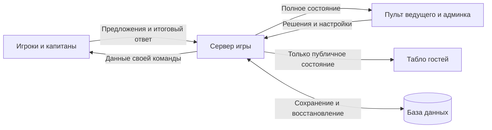

# «100 к 1» ко Дню социолога — план проекта

Статус: рабочая версия размещена через GitHub Actions в Node.js-приложении BrainyCP с PostgreSQL и HTTPS. Развитие интерфейса, статистики и управления партиями описано в дополнении от 15 октября ниже. Результаты проверок — в [отчёте проверки](docs/VALIDATION.md). Репетиция на оборудовании площадки ещё предстоит.

План составлен 14 октября 2026 года. По словам организатора, до мероприятия примерно месяц. Точная дата, площадка и число устройств пока не указаны. Этапы ниже задают порядок работы; их длительность уточняется по результатам разработки.

## 1. Цель и согласованный сценарий

Создать аккуратную, выразительную игру для мероприятия, на котором присутствуют игроки и гости. На общем экране гости видят ход игры; участники используют телефоны; ведущий управляет партией и готовит её в админке.

**Согласовано:** участники команды предлагают варианты, капитан отправляет один итоговый ответ. На общем экране отображается публичное табло. Предусматривается возможность провести игру с устными ответами.

**Рабочие решения для первой версии:** две команды, один ведущий, гости наблюдают за игрой. Итоговый ответ оценивает ведущий. Правила раундов и визуальный стиль ниже — предложения для обсуждения, а не уже утверждённые требования.

## 2. Интерфейсы и роли

| Интерфейс | Кто использует | Что видит и делает |
| --- | --- | --- |
| Общее табло | Гости и игроки, экран или проектор | Вопрос, закрытые ячейки ответов, открытые ответы с очками, названия команд, счёт, ошибки, этап игры и итоги |
| Экран участника | Игрок на телефоне | Входит в команду, предлагает ответ, видит предложения своей команды, статус связи и текущую фазу |
| Экран капитана | Капитан на телефоне | Всё доступное участнику; выбирает или формулирует итоговый ответ и отправляет его в разрешённый момент |
| Пульт ведущего | Ведущий на ноутбуке, планшете или телефоне | Видит все варианты вопроса и ответы команд, управляет ходом, открывает ответы, отмечает ошибки, завершает раунд и исправляет решение |
| Админка | Организатор или ведущий | Готовит вопросы, наборы, команды, правила и оформление; запускает и возобновляет партии |

Пульт ведущего и админка — части одного закрытого интерфейса с разными экранами. Телефон участника и телефон капитана используют один интерфейс с разными правами.

Помимо игровых экранов обязательны главная мероприятия, защищённый мастер первого запуска, вход ведущего, вход игрока, правила и помощь, страницы подготовки игр и вопросов, настройки брендинга и учётной записи, а также состояния ошибок и отсутствия связи. Полная карта маршрутов и сценариев описана в [карте страниц](docs/PAGES.md).

### Табло для гостей

- Полноэкранный режим 16:9 с крупным текстом и хорошим контрастом.
- Экран ожидания с названием мероприятия и командами.
- Экран вопроса с закрытыми ячейками; открытие ответов, очки и ошибки.
- Перерыв, результаты раунда и финальный экран победителей.
- Анимации открытия и изменения счёта; возможность уменьшить анимации и отключить звуки.
- При потере связи — понятный статус и сохранение последнего полученного состояния.
- Размещение по отдельному адресу, который можно открыть на компьютере с проектором.

### Телефоны команды

- Вход по приглашению команды: QR-код или ссылка, затем имя участника.
- Лобби: название команды, капитан и состав.
- Предложения участников доступны своей команде и ведущему.
- Капитан выбирает предложение или вводит собственный итоговый вариант.
- Отправка итогового ответа доступна только капитану команды, которой разрешён ход.
- В одном ходе может ожидать решения только один итоговый ответ команды; новая отправка доступна после решения ведущего и разрешения следующего ответа.
- Подтверждение доставки: «отправляется», «принят сервером», «ожидает ведущего», «решение принято».
- Переподключение и обновление страницы сохраняют принадлежность к команде; недоставленный текст остаётся черновиком.
- При смене фазы устаревший ответ не отправляется автоматически.

В первой версии гости смотрят общее табло. Голосования гостей и участие со своих телефонов можно добавить позднее отдельным режимом, который не меняет очки основной игры.

### Пульт и админка

- Создать набор вопросов и подготовить порядок раундов.
- Ввести названия команд, подтвердить игроков, назначить и заменить капитана.
- Открывать и закрывать вход в команды. Приглашение участника не даёт доступ ведущего.
- Начать игру, показать вопрос, назначить команду хода и разрешить отправку ответа.
- Сопоставить итоговый ответ с вариантом на табло или отметить ошибку.
- Принять устный ответ, если команда играет без телефона.
- Поставить игру на паузу, продолжить, завершить раунд и перейти к следующему.
- Исправить последнее решение; изменение очков сохраняется с причиной в журнале.
- Возобновить незавершённую партию после обновления страницы или перезапуска приложения.
- Экспортировать и импортировать вопросы в документированном формате JSON.

## 3. Правила и состояние игры

Для первой версии предлагаются обычные раунды с множителями очков ×1, ×2 и ×3. По умолчанию у вопроса шесть вариантов ответа; редактор допускает другое количество.

Пример раунда:

1. Ведущий показывает вопрос и определяет, какая команда отвечает первой.
2. Участники предлагают варианты; капитан отправляет итоговый ответ.
3. Ведущий открывает соответствующий вариант. Его очки с учётом множителя добавляются в банк раунда. Либо ведущий отмечает ошибку.
4. После трёх ошибок другая команда получает одну попытку перехвата.
5. При успешном перехвате банк получает перехватывающая команда; при неуспешном — исходная команда. Правило начисления очков за сам ответ перехвата фиксируется до реализации.
6. Если команда открывает все ответы раньше, банк получает она. Ведущий завершает раунд.

Банк раунда и общий счёт команд — разные величины. Уже открытый ответ не начисляется повторно. Принимать смысловые варианты и синонимы решает ведущий; автоматическое распознавание текста в первую версию не входит.

Фазы: лобби → определение первого хода → ответы команды → перехват при необходимости → итоги раунда → следующий раунд или завершение игры. Пауза сохраняет фазу и запрещает игровые действия до продолжения.

Первый ход определяет ведущий по устному розыгрышу. Автоматическая «кнопка на скорость» на телефонах не нужна для первой версии.

Перед реализацией правил уточнить:

- Количество раундов и их множители.
- Нужно ли разрешать передачу хода другой команде.
- Сколько очков добавляет правильный ответ при перехвате.
- Нужен ли обязательный таймер и что происходит по его истечении.
- Требуются ли раунд «Игра наоборот» и «Большая игра» именно к мероприятию.

## 4. Вопросы ко Дню социолога

Вопросы должны быть понятны гостям и поддерживать тему мероприятия. Можно сочетать вопросы о повседневных привычках, обществе, учёбе и работе социолога.

Для каждого вопроса хранятся формулировка, упорядоченные ответы, очки, допустимые смысловые варианты и заметки ведущему. Если использовался реальный опрос, дополнительно сохраняются источник, дата и число респондентов.

Демонстрационные или придуманные результаты обозначаются в материалах ведущего. Их нельзя выдавать за результаты проведённого опроса. Сумма очков не обязана равняться 100: это зависит от опроса и выбранных правил.

До мероприятия нужны готовый основной набор и запасные вопросы. Содержимое текущей партии фиксируется при её запуске: правка библиотеки в админке не меняет вопрос посреди раунда.

## 5. Архитектура — рабочее предложение

| Часть | Предлагаемые технологии | Зачем |
| --- | --- | --- |
| Интерфейсы | React, TypeScript, Vite | Один набор компонентов для табло, телефонов и админки |
| Сервер | Node.js 24 LTS, TypeScript, Fastify | Управление игрой, проверка ролей, HTTP API и соединения обновления |
| Синхронизация | WebSocket для событий, HTTP для команд | Все экраны получают изменения; команда имеет подтверждённый результат |
| База данных | PostgreSQL, драйвер pg и версионируемые SQL-миграции | Сохранение вопросов, партий, участников и решений ведущего без дополнительного этапа генерации ORM |
| Проверки | Vitest и Playwright | Правила, API и сценарии с несколькими независимыми браузерами |
| Деплой | Сборка GitHub Actions; Node.js-приложение BrainyCP, альтернативно Docker Compose | Повторяемая сборка и запуск приложения с БД |

Точные версии зависимостей закреплены в lockfile. Текущий экземпляр работает как Node.js-приложение BrainyCP с отдельной БД PostgreSQL и HTTPS. Docker остаётся альтернативой. Домен и параметры сервера относятся к настройкам экземпляра, а не к коду игры.

Сервер — единственный источник истины для счёта и состояния. Каждая команда получает идентификатор запроса, а состояние — номер версии. Повторная отправка не повторяет действие; устаревшая команда получает отказ с актуальным состоянием. Изменение очков и запись решения выполняются в одной транзакции.

После переподключения клиент получает актуальный снимок состояния. Наличие WebSocket-соединения само по себе не считается подтверждением отправки ответа.

### Разделение данных

- Во время розыгрыша публичное табло получает только открытые ответы. После завершения раунда оно получает статистику всех вариантов этого вопроса; будущие вопросы остаются скрытыми. Полные итоги сыгранных вопросов открываются отдельной публикацией после игры.
- Игрок получает предложения своей команды; предложения соперника ему недоступны.
- Ведущий получает все варианты и решения текущей партии.
- Сервер проверяет роль, принадлежность к команде и фазу для каждого действия.
- Роль капитана назначается ведущим на сервере, а не выбирается самим игроком в браузере.
- Доступ администратора отделён от приглашений игроков. Пароль хранится как хеш; секреты не попадают в репозиторий.
- База данных используется серверным приложением и не открывается для участников напрямую.

## 6. Основные сущности БД

Это логическая схема; имена таблиц и точные поля будут уточнены при реализации.

| Сущность | Основные данные |
| --- | --- |
| AdminUser | Учётная запись организатора, хеш пароля, права |
| InstallationState | Завершение первичной настройки и защищённые данные одноразового доступа |
| SiteSettings | Название мероприятия, организатор, тема и настройки интерфейса |
| MediaAsset | Загруженные логотипы и изображения, тип, размер и место хранения |
| QuestionPack | Название, описание, тема и порядок вопросов |
| Question | Текст, источник и дата опроса, число респондентов, заметки |
| SurveyAnswer | Вопрос, текст ответа, очки, порядок и смысловые варианты |
| GameSession | Название, статус, текущая фаза и раунд, версия состояния, правила, снимки вопросов и брендинга |
| SessionTeam | Партия, название, цвет, общий счёт |
| Participant | Команда, имя, роль участника или капитана, данные сессии входа |
| Round | Партия, вопрос из снимка, множитель, активная команда, ошибки, банк, статус |
| Suggestion | Раунд, команда, автор и текст предложения |
| OfficialAnswer | Раунд, команда, капитан, итоговый текст, статус решения, идентификатор запроса |
| AnswerReveal | Раунд, открытый вариант, момент открытия, связанное решение |
| GameEvent | Последовательность действий, автор, тип, изменение очков, причина исправления и время |
| RoundResult | Снимок итога сыгранного раунда, открытые ответы, победитель, начисленные очки, множитель и признак завершённости |

Сохранённая партия содержит всё необходимое для восстановления текущего вопроса, открытых ответов, банка, ошибок и счёта. Журнал помогает разбирать и исправлять решения ведущего; сам по себе он не заменяет проверку актуального состояния.

## 7. Визуальное направление

Предлагается оформление в духе телевизионной игры: крупное табло, карточки ответов, два различимых цвета команд, выразительная типографика и короткие анимации. Цветовая палитра, логотип мероприятия и фон обсуждаются до окончательного оформления.

Настраиваемый брендинг входит в первую версию: название, логотипы, основные цвета, фон и значок сайта. Единая тема используется на главной, входе, в лобби, на телефонах, табло, итоговом экране и служебных страницах. Оформление задаётся при первом запуске и меняется в админке с предпросмотром. Для текущей партии сохраняется снимок темы. Подробности — в [карте страниц и первого запуска](docs/PAGES.md).

Табло проектируется для чтения из зала. Пульт — для быстрых и понятных действий. Телефон — для ввода текста и выбора ответа одной рукой. Кириллица, длинные названия команд и длинные ответы проверяются отдельно.

Состояния «ход соперника», «ответ отправлен», «игра на паузе» и «нет связи» объясняются словами, а не только цветом. Звуки включаются явным действием пользователя с учётом ограничений браузера.

## 8. Этапы разработки

Работа ведётся в существующем checkout репозитория. Дополнительный Git worktree для обычной задачи не требуется.

### Этап 0. Уточнения и прототип экранов

- Зафиксировать правила первой партии, ожидаемый состав и точную дату мероприятия.
- Подготовить схему переходов и макеты табло, пульта и телефонов.
- Подготовить макеты главной, мастера первого запуска, входа и обязательных служебных состояний.
- Определить тему оформления и источник вопросов.
- Уточнить домен, размещение на сервере и доступ к сети на площадке.

Результат: понятный сценарий одного раунда и согласованный набор экранов.

### Этап 1. Основа проекта и игра с ведущим

- Создать структуру приложения, закрепить инструменты и зависимости.
- Подготовить БД, миграции и серверные правила.
- Реализовать защищённый мастер первого запуска, создание владельца, сохранение базовых настроек и запрет повторной установки.
- Добавить главную, входы по ролям, правила и помощь, навигацию и базовые служебные экраны.
- Реализовать закрытый вход ведущего, создание партии и команды.
- Соединить пульт и общее табло.
- Провести полный обычный раунд: открытие ответов, ошибки, перехват и начисление банка.
- Сохранять игру и восстанавливать её после перезапуска.

Результат: игра работает с устными ответами без телефонов участников.

### Этап 2. Участники и капитаны на телефонах

- Реализовать приглашения, лобби и состав команд.
- Добавить предложения участников и выбор итогового ответа капитаном.
- Проверять ход команды и роль отправителя на сервере.
- Реализовать подтверждение доставки и восстановление связи.
- Проверить партию с двумя командами в разных браузерах и на телефонах.

Результат: согласованный сценарий «участники предлагают, капитан отправляет» работает целиком.

### Этап 3. Полноценная подготовка игры

- Добавить редактор вопросов и наборов, импорт и экспорт.
- Реализовать настройки раундов, названий команд и оформления.
- Добавить загрузку логотипов, редактор брендинга и предпросмотр табло и телефона; сохранить оформление партии.
- Реализовать настройки учётной записи и документированный способ восстановления доступа.
- Добавить журнал, исправления решений, паузу и возобновление.
- Подготовить тематический основной набор и запасные вопросы.

Результат: организатор самостоятельно готовит и проводит новую партию.

### Этап 4. Оформление, проверки и размещение

- Оформить интерфейсы, переходы и итоговый экран.
- Проверить проектор, телефоны, длинные тексты и звуки.
- Выполнить автоматические и функциональные проверки ниже.
- Подготовить проверяемую сборку, GitHub Actions и размещение с HTTPS.
- Провести репетицию на площадке или с сопоставимым оборудованием.
- Сохранить инструкции ведущему, резервную копию вопросов и способ восстановления.

Результат: готовый сценарий мероприятия с проверенным запуском и резервными материалами.

### Ориентир на месяц

| Период | Главный результат |
| --- | --- |
| Неделя 1 | Макеты, правила и рабочий раунд с пультом и табло |
| Неделя 2 | Телефоны участников, капитаны и полный командный сценарий |
| Неделя 3 | Админка, содержимое игры и визуальное оформление |
| Неделя 4 | Проверки, размещение, репетиция и исправления |

Ориентир уточняется по результатам этапов. Последние дни перед мероприятием сохраняются для репетиции и исправления найденных проблем.

## 9. Проверки готовности

Ниже перечислены критерии готовности. Итоговые результаты проверок фиксируются в документации первой версии; репетиция на оборудовании мероприятия остаётся отдельным этапом.

- Полный первый запуск: защищённая настройка, первый администратор, брендинг, создание игры и повторный вход.
- Повторный запуск, одновременные запросы установки и обновление версии не сбрасывают приложение и не создают новых владельцев.
- Все обязательные страницы, служебные состояния и восстановление доступа работают по [карте страниц](docs/PAGES.md).
- Брендинг читается на телефоне и проекторе, сохраняется после перезапуска и не меняет текущую партию при правке общих настроек.

- Полная партия с двумя командами, участниками, капитанами, ведущим и табло.
- Полный раунд с устными ответами без телефонов игроков.
- Верный ответ, неверный ответ, повтор уже открытого варианта, три ошибки, успешный и неуспешный перехват.
- Множители, завершение раунда, однократное зачисление банка, исправление решения и правильный итоговый счёт.
- Участник не может отправить официальный ответ вместо капитана; команда не отвечает вне своего хода.
- Повторная отправка и два одновременных действия не дублируют очки и решения.
- Обновление страниц, краткая потеря связи, смена капитана и возвращение участников.
- Перезапуск приложения сохраняет незавершённую игру.
- Скрытые ответы отсутствуют в сетевых данных табло и телефонов. Предложения соперника недоступны игроку.
- Проверка реальных телефонов, ноутбука ведущего и читаемости проектора.
- Проверка одновременных подключений по ожидаемому числу участников; пока ориентир — 100 соединений, окончательная нагрузка уточняется.
- Резервное копирование, восстановление данных, запуск после деплоя и возврат к предыдущей рабочей версии.

При проблемах только с телефонами ведущий может принимать устные ответы, пока пульт и табло имеют связь с приложением. Полная потеря доступа к серверу требует отдельного резервного сценария: экспорт вопросов, сохранённые материалы и подготовка ведущего. Полноценный автономный режим на площадке не заявляется как функция первой версии.

## 10. Размещение и текущее состояние доступа

- Вход с Windows новым ключом на сервер экземпляра проверен; его адрес и домен задаются в локальных настройках размещения.
- Пользователь подтвердил добавление `DEPLOY_SSH_KEY` в GitHub Actions Secrets.
- Сценарий GitHub Actions использует SSH-секрет и проверенный публичный ключ сервера для размещения.
- Серверные операции облачного Codex выполняются через GitHub Actions; закрытый SSH-ключ не копируется в рабочее окружение.
- На сервере работают другие сайты. Для игры подготовлены отдельные БД, Node.js 24 и служба приложения, настроены HTTPS и proxy. Код не содержит домена экземпляра.

Размещение: GitHub Actions проверяет и собирает приложение, а отдельный ручной запуск деплоя переносит проверенную версию на сервер. После запуска выполняется функциональная проверка. Для восстановления сохраняются предыдущая версия и резервная копия данных; миграции БД рассматриваются отдельно от переключения версии приложения. Проверка восстановления всей БД остаётся отдельным пунктом репетиции.

Наличие ключа с парольной фразой нужно учесть при настройке сценария. Секреты вводятся через защищённые настройки, их значения не сохраняются в документах.

Команды создания ключа, проверки входа и сохранения секрета находятся в [памятке по SSH](docs/SSH_DEPLOY_GUIDE.md).

## 11. Возможности следующих версий

После рабочего основного сценария можно добавить «Игру наоборот», «Большую игру», голосования гостей, турнир нескольких команд, библиотеку прошлых мероприятий и автономный запуск на площадке. Их приоритет определяется после репетиции первой версии либо отдельно, если они окажутся обязательными для мероприятия.

## 12. Контрольные точки

- [x] Описаны интерфейсы для гостей, ведущего и команд.
- [x] Описаны обязательные страницы, мастер первого запуска, брендинг и служебные состояния.
- [x] Подтверждён сценарий: участники предлагают, капитан отправляет.
- [x] Сохранены план проекта и памятка по SSH.
- [ ] Уточнены правила раундов, дата, число устройств и размещение.
- [x] Реализованы первый запуск, входы по ролям и обязательные страницы.
- [x] Работает настройка брендинга с предпросмотром.
- [x] Рабочая партия с ведущим и табло.
- [x] Рабочая партия с телефонами команд.
- [x] Организатор может подготовить игру в админке.
- [x] Выполнены проверки правил, синхронизации и доступа.
- [ ] Проверен деплой и восстановление.
- [ ] Проведена репетиция мероприятия.

## 13. Дополнение от 15 октября 2026 года

В развитие первой версии добавлены:

- Светлая контрастная тема «Проектор» и переключатель для текущего табло без изменения настроек остальных устройств.
- Упрощённые действия ведущего на телефоне, явные роли игрока и капитана, удобная мобильная навигация.
- Сброс партии с новыми приглашениями и удаление партии с подтверждением. Библиотека вопросов сохраняется в обоих случаях.
- Инфографика после раунда: все варианты вопроса, очки, доли суммы очков, угаданные ответы и сведения об опросе. Реальное число опрошенных не подменяется суммой игровых очков.
- Страница `/results/:gameId` с финальным счётом и сыгранными вопросами. Организатор сначала смотрит её сам, затем явно публикует для гостей; публикацию можно закрыть. Сброс и возврат к незавершённой игре закрывают публичные итоги.

Сценарии описаны в [памятке ведущему](docs/GAME_GUIDE.md), права и поля — в [API](docs/API.md). Текущие результаты проверок фиксируются в [VALIDATION.md](docs/VALIDATION.md).

Для работы с содержимым добавлен мастер `/admin/questions/import`: JSON-файл до 3 МиБ или текст, общая клиентская и серверная проверка, ошибки по вопросам и полям, предпросмотр всех вариантов и явное сохранение. Обновление совпадающих UUID требует согласия; «Добавить все как новые» сохраняет отдельные копии. Мастер предлагает учебный JSON и запрос для внешнего ИИ. Изменения библиотеки не меняют снимки партий.

Сценарий подготовки данных: выгрузка из Яндекс Анкет → внешняя обработка и группировка через ИИ → JSON формата игры → проверка организатором в мастере → библиотека вопросов. Прямого подключения к Яндекс Анкетам и автоматической обработки сырых CSV-ответов внутри приложения пока нет. [Формат и требования к данным](docs/SURVEY_IMPORT.md) описаны отдельно; дальнейшая автоматизация должна сохранять исходные количества, происхождение и правила объединения ответов.
